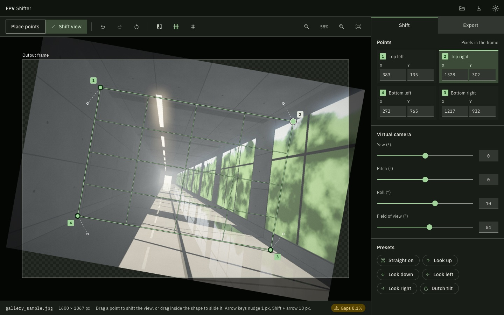
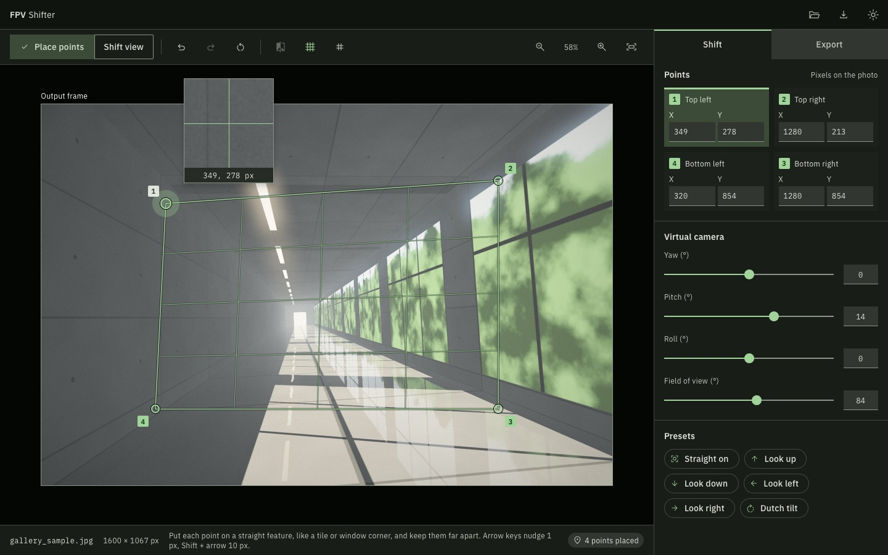
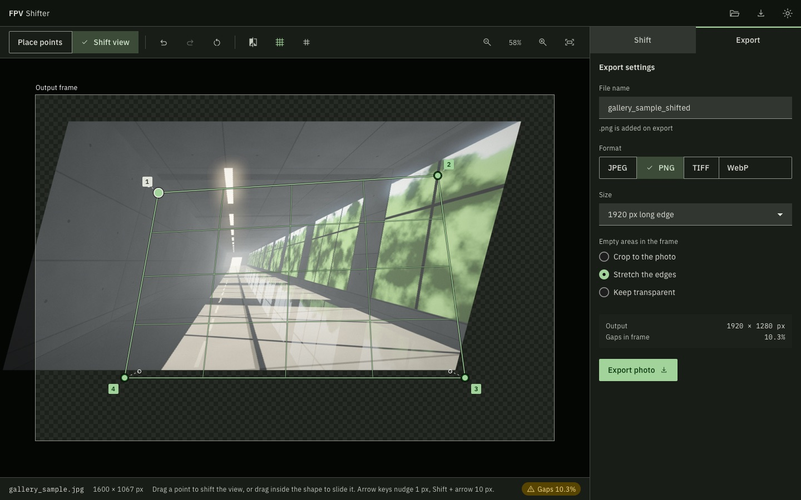

# FPV Shifter

A desktop photo editor that changes a photo's first-person viewpoint using 4 points. Pin the points to the photo, move them, and the whole photo warps to follow. Then export the result at full resolution.



It runs on macOS, Windows and Linux, and works fully offline. Your photos stay on your computer, and the app makes no network requests.

## Contents

- [Features](#features)
- [Download and install](#download-and-install)
- [How to use it](#how-to-use-it)
- [Keyboard shortcuts](#keyboard-shortcuts)
- [Export options](#export-options)
- [Limits](#limits)
- [Build it yourself](#build-it-yourself)
- [Publish a release](#publish-a-release)
- [How it is built](#how-it-is-built)

## Features

- **Live perspective warp:** drag any of the 4 points and the photo follows as you move.
- **Virtual camera:** turn the view with yaw, pitch, roll and field of view sliders, which stay in step with your dragging.
- **Presets:** straight on, look up, look down, look left, look right and Dutch tilt.
- **Precise placement:** pin points to straight features with a magnifying loupe, or type exact pixel positions.
- **Compare:** drag a divider across the shifted view and the original.
- **Guides:** a perspective mesh and a rule of thirds grid.
- **Full-resolution export:** JPEG, PNG, TIFF or WebP, keeping the colour profile.
- **Safe with your originals:** the app refuses to overwrite the photo you opened, and a failed or cancelled export leaves no file behind.
- **Dark and light themes,** with up to 50 undo steps.

## Download and install

Download the latest version from the [releases page](../../releases/latest).

| System | File |
| --- | --- |
| macOS, Apple Silicon (M1 or later) | `FPV-Shifter_<version>_aarch64.dmg` |
| macOS, Intel | `FPV-Shifter_<version>_x64.dmg` |
| Windows | `FPV-Shifter_<version>_x64-setup.exe`, or the `.msi` |
| Linux, Debian or Ubuntu | `FPV-Shifter_<version>_amd64.deb` |
| Linux, other | `FPV-Shifter_<version>_amd64.AppImage` |

The builds are not code-signed, so your system warns you the first time. Each release also includes `SHA256SUMS.txt`, so you can check your download.

### macOS

1. Open the `.dmg` and drag **FPV Shifter** to **Applications**.
2. Open the app. macOS says it can't verify the developer, so click **Done**.
3. Go to **System Settings > Privacy & Security**, scroll down, and click **Open Anyway**.

### Windows

Run the installer. If SmartScreen warns you, click **More info**, then **Run anyway**. The installer downloads Microsoft WebView2 if your PC doesn't have it, which needs an internet connection that one time.

### Linux

On Debian or Ubuntu:

```bash
sudo apt install ./FPV-Shifter_<version>_amd64.deb
```

Or use the AppImage:

```bash
chmod +x FPV-Shifter_<version>_amd64.AppImage
./FPV-Shifter_<version>_amd64.AppImage
```

## How to use it

Each point has two positions: an **anchor**, the pixel on the photo it is pinned to, and a **target**, where that pixel lands in the output frame. Those 4 pairs define the warp.

### 1. Open a photo

Click **Open photo** or drop a JPEG, PNG, TIFF or WebP onto the window. To try the app first, click **Use the sample photo**.

### 2. Place the points (optional)

Choose **Place points**. The photo is shown unwarped, and a loupe appears while you drag. Pin each point to a straight feature, like a tile or a window corner, and keep them far apart. Moving an anchor keeps any shift you have already made.



### 3. Shift the view

Choose **Shift view**, then use any mix of these:

| Do this | To get this |
| --- | --- |
| Drag a point | Move that corner. The sliders update to match |
| Drag inside the shape | Slide all 4 points together |
| Press an arrow key on a point | Nudge it 1 px, or 10 px with Shift |
| Type in an X or Y field | Set an exact position. Up and down arrows step it by 1, or 10 with Shift |
| Move a camera slider | Turn the view, moving all 4 points together |
| Click a preset | Animate to that pose, measured from the unshifted photo |
| Click **Reset the shift** | Go back to no shift. Anchors stay where they are |

| Slider | A positive value means |
| --- | --- |
| Yaw | Look right: the right side of the photo gets smaller |
| Pitch | Look up: the top of the photo gets smaller |
| Roll | Tilt clockwise |
| Field of view | Below 84° zooms in, above 84° zooms out |

The status bar shows how much of the frame the photo fills. **Gaps** means part of the frame is empty, shown as a checkerboard.

The 4 points must form a convex four-sided shape. If a move breaks that, the edges turn red and the photo holds its last good shape. When you let go, the point snaps back. A slider stays where it is until you ease it back.

### 4. Export

Open the **Export** tab, choose your settings, and click **Export photo**. The panel shows the exact output size before you save.



## Keyboard shortcuts

Use `Cmd` on macOS and `Ctrl` on Windows and Linux.

| Action | Shortcut | Action | Shortcut |
| --- | --- | --- | --- |
| Open photo | `Cmd+O` | Fit to window | `Cmd+0` |
| Go to export | `Cmd+E` | Zoom in | `Cmd+=` |
| Quit | `Cmd+Q` | Zoom out | `Cmd+-` |
| Undo | `Cmd+Z` | Compare | `Cmd+Shift+C` |
| Redo | `Cmd+Shift+Z` | Perspective mesh | `Cmd+Shift+M` |
| Reset the shift | `Cmd+Shift+R` | Thirds grid | `Cmd+Shift+G` |
| | | Switch theme | `Cmd+Shift+T` |

## Export options

| Setting | Options | Notes |
| --- | --- | --- |
| Format | JPEG, PNG, TIFF, WebP | |
| Size | Original, or a long edge of 3840, 2560, 1920 or 1280 px | Keeps the aspect ratio |
| Quality | 40 to 100% | JPEG and WebP only |
| Empty areas | Crop to the photo, Stretch the edges, Keep transparent | Keep transparent is not available for JPEG |

What the empty area options do:

- **Crop to the photo:** cuts to the largest rectangle with the frame's shape that has no gaps. At Original size the result is smaller than the frame.
- **Stretch the edges:** fills gaps by repeating the pixels at the photo's edge.
- **Keep transparent:** leaves gaps transparent.

What each format keeps from your original:

| Format | Colour profile | EXIF |
| --- | --- | --- |
| JPEG | Yes | Yes |
| PNG | Yes | Yes |
| TIFF | Yes | No |
| WebP | Yes | Yes |

EXIF can include the location where a photo was taken, so check it before you share an export publicly. XMP and other metadata are not kept.

## Limits

- Photos can be up to 400 megapixels. Larger ones are refused with a message.
- Exports are 8 bits per channel, so 16-bit PNG and TIFF files lose their extra precision.
- Camera raw files can't be opened.
- WebP exports can be at most 16383 px on each side.
- On macOS, quitting from the Dock may not warn you about unexported work. The menu, `Cmd+Q` and the close button all do.
- The preview always shows gaps as a checkerboard, whichever empty area option you choose.

## Build it yourself

### What you need

- [Node.js](https://nodejs.org) and [Rust](https://rustup.rs)
- The [Tauri system dependencies](https://v2.tauri.app/start/prerequisites/) for your platform

If you installed Rust without letting it edit your shell profile, run `source "$HOME/.cargo/env"` first.

### Run it in development

```bash
npm install
npm run tauri dev
```

### Run the checks

```bash
npm test
npm run build
cargo test --manifest-path src-tauri/Cargo.toml
```

### Build installers

```bash
npm run tauri build
```

Tauri builds installers for the system it runs on, and puts them in `src-tauri/target/release/bundle/`:

| System | Result |
| --- | --- |
| macOS | `.app` and `.dmg` |
| Windows | `.exe` and `.msi` |
| Linux | `.deb` and `.AppImage` |

On macOS, the `.dmg` step asks Finder to arrange the window, so macOS may ask for permission to control Finder. If it times out, run `CI=true npm run tauri build`, which skips that step.

## Publish a release

1. Update the version in `package.json`, `src-tauri/Cargo.toml` and `src-tauri/tauri.conf.json`.
2. Commit that change.
3. Push a matching tag:

   ```bash
   git tag v0.2.0
   git push origin v0.2.0
   ```

GitHub then builds all the installers and runs the tests on each system. The release is only published if every build passes, and the build stops if the tag doesn't match the version in `tauri.conf.json`.

To build without publishing anything, run the **Release** workflow by hand from the Actions tab. The installers appear as workflow artifacts.

## How it is built

Built with [Tauri 2](https://v2.tauri.app). Rust handles files and export, and plain TypeScript with no UI framework handles the editor.

The preview is a CSS transform, so it stays live as you drag. Export is a separate render in Rust. It maps each output pixel backwards to the full-resolution original, using the same maths as the preview. Both are tested against shared data in `fixtures/homography.json`, which is generated from the design's reference code, so the two agree.

| Path | What it holds |
| --- | --- |
| `src/engine/` | The warp, camera and coverage maths |
| `src/ui/` | Rendering and input |
| `src/native/` | The only code that calls Tauri |
| `src-tauri/src/` | Decoding, export, dialogs and menus |
| `design/` | The design this app was built from. Start with `design.md` |
| `docs/ARCHITECTURE.md` | How the code fits together |
| `docs/DECISIONS.md` | Choices the design did not specify, and known limits |
| `docs/TEST-BY-HAND.md` | What automated tests cannot confirm |

Run `npm run fixtures` to regenerate the shared test data from `design/index.html`.
